<!-- ===================== HERO ===================== -->

  <picture>
    <source media="(prefers-color-scheme: dark)" srcset="./cards/hero-dark.svg">
    <source media="(prefers-color-scheme: light)" srcset="./cards/hero-light.svg">
    
  </picture>

<!-- ===================== CONTRIBUTION GRAPH ===================== -->

  <picture>
    <source media="(prefers-color-scheme: dark)" srcset="./cards/graph-dark.svg">
    <source media="(prefers-color-scheme: light)" srcset="./cards/graph-light.svg">
    
  </picture>

<!-- ===================== MONTHLY BARS ===================== -->

  <picture>
    <source media="(prefers-color-scheme: dark)" srcset="./cards/months-dark.svg">
    <source media="(prefers-color-scheme: light)" srcset="./cards/months-light.svg">
    
  </picture>

<!-- ===================== THREE TILES ===================== -->

  
  
  

 

<!-- ===================== BADGES ===================== -->

  
  
  

 

<!-- ===================== ABOUT ===================== -->
<h2 align="center">✨ About Me</h2>

  Final-year <b>B.E. Information Technology</b> student at <b>SVIT Nashik</b> building technically ambitious projects 
  across <b>full-stack web</b>, <b>computer vision</b>, <b>hardware</b> and <b>mobile</b>.  
  🔭 Building AI proctoring, phishing detection and a Kumbh Mela 2027 companion app 
  🌱 Learning React and Data Structures in Java 
  🐧 Linux (KDE Plasma), terminal-first workflow 
  🤝 Open to hackathons, open-source collabs and internships

 

<!-- ===================== TECH STACK ===================== -->
<h2 align="center">💻 Tech Stack</h2>

<table align="center" width="100%" border="0">
  <tr>
    <td width="50%" align="center" valign="top">
      <h3>🧬 Languages</h3>
      
      
      
      
      
      
      
      
    </td>
    <td width="50%" align="center" valign="top">
      <h3>🌐 Frontend</h3>
      
      
      
      
      
    </td>
  </tr>
  <tr>
    <td width="50%" align="center" valign="top">
      <h3>⚙️ Backend & Databases</h3>
      
      
      
      
      
    </td>
    <td width="50%" align="center" valign="top">
      <h3>📱 Mobile & Desktop</h3>
      
      
    </td>
  </tr>
  <tr>
    <td width="50%" align="center" valign="top">
      <h3>🤖 AI, Vision & Hardware</h3>
      
      
      
      
      
      
      
    </td>
    <td width="50%" align="center" valign="top">
      <h3>🧰 Tools & Environment</h3>
      
      
      
      
      
      
      
      
      
    </td>
  </tr>
</table>

 

<!-- ===================== PROJECTS ===================== -->
<h2 align="center">🚀 Featured Projects</h2>

<table align="center" width="100%" border="0">
  <tr>
    <td width="50%" align="center">
      
    </td>
    <td width="50%" align="center">
      
    </td>
  </tr>
  <tr>
    <td width="50%" align="center">
      
    </td>
    <td width="50%" align="center">
      
    </td>
  </tr>
  <tr>
    <td width="50%" align="center">
      
    </td>
    <td width="50%" align="center">
      
    </td>
  </tr>
</table>

 

<!-- ===================== STATS ===================== -->
<h2 align="center">📊 GitHub Stats</h2>

  
  

 

  

 

<!-- ===================== TROPHIES ===================== -->
<h2 align="center">🏆 Trophy Case</h2>

  

 

<!-- ===================== SNAKE ===================== -->
<h2 align="center">🐍 Contribution Snake</h2>

  <picture>
    <source media="(prefers-color-scheme: dark)" srcset="https://raw.githubusercontent.com/rxut-04/rxut-04/output/github-snake-dark.svg">
    <source media="(prefers-color-scheme: light)" srcset="https://raw.githubusercontent.com/rxut-04/rxut-04/output/github-snake.svg">
    
  </picture>

<!--
  GITHUB ACTION SETUP (Platane/snk)
  Create the file: .github/workflows/snake.yml

  name: Generate Snake
  on:
    schedule:
      - cron: "0 0 * * *"
    workflow_dispatch:
  permissions:
    contents: write
  jobs:
    generate:
      runs-on: ubuntu-latest
      steps:
        - uses: Platane/snk/svg-only@v3
          with:
            github_user_name: ${{ github.repository_owner }}
            outputs: |
              dist/github-snake.svg
              dist/github-snake-dark.svg?palette=github-dark
        - uses: crazy-max/ghaction-github-pages@v3.1.0
          with:
            target_branch: output
            build_dir: dist
          env:
            GITHUB_TOKEN: ${{ secrets.GITHUB_TOKEN }}

  Then: Actions tab → "Generate Snake" → Run workflow (first run only).
-->

 

  

 

<!-- ===================== CONNECT ===================== -->
<h2 align="center">🤝 Let's Connect</h2>

  
  
  
  
  
  

 

<!-- ===================== FOOTER ===================== -->

  

